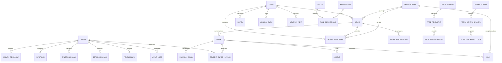

# Relasi Database SIMS

Dokumen ini merangkum relasi yang dinyatakan di `database.sql` dan file migrasi. Schema pada database lokal tetap sumber kebenaran untuk deployment; sebelum migrasi, cocokkan nama kolom, tipe, indeks, constraint, trigger, dan view melalui `information_schema` serta lakukan backup.

Diagram adalah ringkasan konsep, bukan DDL. Beberapa tabel/kolom hanya tersedia setelah migrasi tertentu. Tabel relasi yang tidak mencantumkan FK eksplisit di diagram harus tetap diperiksa melalui schema aktual.

## Relasi inti yang didefinisikan pada schema awal

| Tabel/kolom | Tabel tujuan | Aturan hapus |
|---|---|---|
| `kelas.wali_guru_id` | `guru.id` | `SET NULL` |
| `kelas.tahun_ajaran_id` | `tahun_ajaran.id` | `RESTRICT` |
| `siswa.kelas_id` | `kelas.id` | `RESTRICT` |
| `mapel.guru_id` | `guru.id` | `SET NULL` |
| `nilai.siswa_id`, `nilai.mapel_id`, `nilai.tahun_ajaran_id` | `siswa`, `mapel`, `tahun_ajaran` | `RESTRICT` |
| `absensi.siswa_id` | `siswa.id` | `RESTRICT` |
| `absensi_guru.guru_id` | `guru.id` | `RESTRICT` |
| `absensi_guru.created_by` | `users.id` | `SET NULL` |
| `jadwal_pelajaran.kelas_id`, `mapel_id`, `tahun_ajaran_id` | `kelas`, `mapel`, `tahun_ajaran` | `RESTRICT` |
| `jadwal_pelajaran.guru_id` | `guru.id` | `SET NULL` |
| `kelas_berlangsung.kelas_id`, `mapel_id` | `kelas`, `mapel` | `RESTRICT` |
| `kelas_berlangsung.jadwal_id`, `guru_id` | `jadwal_pelajaran`, `guru` | `SET NULL` |
| `kelas_binaan.kelas_id`, `guru_id`, `tahun_ajaran_id` | `kelas`, `guru`, `tahun_ajaran` | `RESTRICT` |
| `rencana_ajar.guru_id`, `kelas_id`, `mapel_id`, `tahun_ajaran_id` | `guru`, `kelas`, `mapel`, `tahun_ajaran` | `RESTRICT` |
| `kegiatan_kokurikuler.kelas_id`, `penanggung_jawab_id` | `kelas`, `guru` | `SET NULL` |
| `notifikasi.recipient_user_id` | `users.id` | `CASCADE` |

## Relasi dari migrasi

- `student_class_history` menyimpan siswa, kelas/tahun ajaran asal dan tujuan, serta aktor. Data induk kelas/tahun/siswa memakai `RESTRICT`; penghapusan akun aktor menjadikan `actor_user_id` `NULL`.
- `roles` dan `permissions` dihubungkan oleh `role_permissions`; penghapusan role/permission menghapus grant terkait (`CASCADE`).
- `audit_logs.actor_user_id` mengarah ke `users.id` dan menjadi `NULL` bila akun dihapus.
- Profil biodata dan beberapa riwayat autentikasi terhubung ke `users`; aturan penghapusan mengikuti file migrasi terkait.
- Materi dan tugas mengarah ke guru, kelas, mapel, serta tahun ajaran. Pengumpulan tugas mengarah ke tugas dan siswa; tugas yang dihapus dapat menghapus pengumpulan (`CASCADE`), sedangkan siswa dibatasi (`RESTRICT`).
- Pendaftaran PPDB terkait ke periode dengan `RESTRICT`; riwayat status terkait ke pendaftar dan petugas.
- Percakapan publik, balasan, dan antrean email dihubungkan oleh foreign key pada migrasi kontak/email.
- Tabel `staff` sengaja terpisah dari `guru`; tidak ada pemindahan data otomatis.

## Aturan menjaga integritas

1. Jangan menghapus siswa, guru, kelas, tahun ajaran, nilai, atau absensi hanya untuk merapikan daftar jika masih ada relasi penting.
2. Gunakan status arsip/nonaktif untuk data historis apabila kebijakan sekolah mengharuskan penyimpanan.
3. Perubahan skema harus dibuat sebagai migrasi baru yang tercatat/checksum; jangan mengedit migrasi yang sudah diterapkan.
4. Periksa constraint aktual sebelum merancang impor massal atau operasi hapus.
5. Uji migrasi dan pemulihan pada salinan database, bukan dengan mengubah `sims_db` untuk percobaan.
